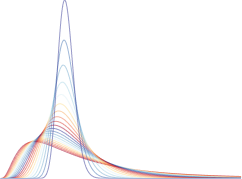

```{r, include=FALSE}
knitr::opts_chunk$set(
  results='asis', 
  echo = FALSE
)
library(tidyverse)
library(glue)

# Set this to true to have links turned into footnotes at the end of the document
PDF_EXPORT <- FALSE

# Holds all the links that were inserted for placement at the end
links <- c()

source('parsing_functions.R')


# First let's get the data, filtering to only the items tagged as
# Resume items
position_data <- read_csv('positions.csv') %>% 
  filter(in_resume) %>% 
  mutate(
    # Build some custom sections by collapsing others
    section = case_when(
      section %in% c('research_positions', 'industry_positions') ~ 'positions', 
      section %in% c('data_science_writings', 'by_me_press') ~ 'writings',
      TRUE ~ section
    )
  ) 

```


Aside
================================================================================


{width=100%}

Contact {#contact}
--------------------------------------------------------------------------------

- <i class="fa fa-github"></i> github.com/j-symiakakis


Skills {#skills}
--------------------------------------------------------------------------------

- Data Analytics
- R
- Data Visualization
- Business Analysis
- International Business


Disclaimer {#disclaimer}
--------------------------------------------------------------------------------

Made w/ [**pagedown**](https://github.com/rstudio/pagedown). 

Source code: github.com/j-symiakakis/cv

Last updated on `r Sys.Date()`.


Main
================================================================================

Jaclyn Symiakakis {#title}
--------------------------------------------------------------------------------

```{r}
intro_text <- "Data analytics professional with experience in business analysis and data analytics. Background includes international business, healthcare, wine production, and service in the United States Air Force."

cat(sanitize_links(intro_text))
```


Education {data-icon=graduation-cap data-concise=true}
--------------------------------------------------------------------------------

```{r}
position_data %>% print_section('education')
```


Selected Positions {data-icon=suitcase}
--------------------------------------------------------------------------------

```{r}
position_data %>% print_section('positions')
```

Technical Skills {data-icon=laptop}
--------------------------------------------------------------------------------

<div style="margin-left: 70px;">

**Data Analysis:** R, RStudio, data cleaning, statistical analysis, data visualization

**Methods:** Regression, fixed effects, difference-in-differences, interrupted time series

**Spatial Analysis:** GIS, spatial analysis, choropleth and bivariate mapping

**Tools:** Git, GitHub, R Markdown, Quarto

</div>


Selected Data Analytics Projects {data-icon=chart-line}
--------------------------------------------------------------------------------

```{r}
position_data %>% print_section('projects')
```

Certifications & Additional Training {data-icon=certificate}
--------------------------------------------------------------------------------

<div style="margin-left: 70px;">

**Winemaking Certification**  
University of California, Davis

</div>
